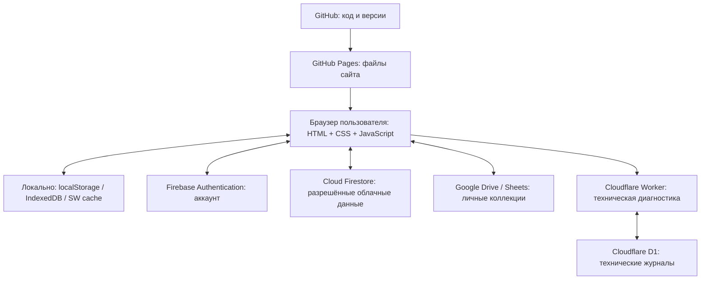

# Sanastoyhteisö 3.0 — действующая архитектура, переносимость и резервирование
**Проверено по main 09.11.2026 · RUN171 · исходный commit `fcc6339430810880bb21c50795ecb5ea86b1fe03`.** Это справочный документ для будущих чатов. Перед миграцией заново сверять изменившуюся реализацию, но не просить владельца объяснять структуру с нуля.

## Что это за система
- **Не CMS и не WordPress.** Самостоятельное клиентское SPA/PWA без собственного традиционного веб-сервера: `index.html`, `style.css`, `app.js`, `data.js`, `riveria-anatomy-exam.js`, и другие JS-модули. Клиентский JavaScript работает прямо в браузере; `manifest.webmanifest` и `sw.js` дают установку на экран и офлайн-кэш. ES5-совместимость важна для iOS 12 (проверять на живом устройстве).
- **Исходники, CI и релизы:** GitHub repo `sanastoyhteiso/sanastoyhteiso.github.io`. GitHub Pages обслуживает публичные файлы `https://sanastoyhteiso.github.io/` из опубликованного `main`. Сама веб-страница **не хостится на Cloudflare Worker**.
- **Словари:** статическая общая база `data.js` и дополнительные записи `riveria-anatomy-exam.js`; последний подтверждённый RUN170 — 1485 уникальных FI терминов. 10 экзаменационных анатомических тем `EXAM01`–`EXAM10`; типы тестов, карточки и 40-вопросный пробный экзамен работают по клиентскому коду. `riveria-anatomy-exam.js` хранит `examTopics` с `id/fi/ru/pages`. Pages остаются в метаданных даже если удалены только из видимых выпадающих меню.
- **Устройство пользователя:** браузерный `localStorage` для части прогресса, пользовательских настроек и черновика 40-вопросного экзамена; IndexedDB в механизме V3; Cache Storage и service worker для офлайн-ресурсов. Офлайн-хранилище не является гарантированной резервной копией — нельзя предлагать очистку данных сайта без проверки.
- **Firebase:** клиентская конфигурация в `config.js` (публичные идентификаторы; никаких секретных ключей). Firebase Authentication управляет аккаунтами и подтверждением email, Cloud Firestore обслуживает предусмотренные защищённые коллекции, в т. ч. `sync_v3/{uid}/events`, `mock_exam_progress_v1/{uid}`, публичные метаданные и настройки. **Наличие кодового модуля и нулевой очереди V3 не доказывает, что каждый вид данных реально синхронизирован в облако.** Отдельно учитывать квоты Firestore и фактические Security Rules.
- **Google Drive/Sheets:** `community.js` поддерживает подключение личного Google Drive, приватную Google-таблицу `Riveria Sanasto Private v2`, совместный доступ через отдельные опубликованные таблицы по явному согласию. Это дополнительная система обмена/резервирования, а не полная копия Firestore/Auth.
- **Мониторинг:** отдельный Cloudflare Worker `sanastoyhteiso-v3-telemetry`, D1 binding `DB`; только диагностика и журнал технических событий (не основная БД пользователей/словаря/прогресса). Запросы по HTTPS к `workers.dev` из клиента; Cloudflare Worker **не проксирует** основной сайт. Развертывание Worker — отдельное от GitHub Pages действие; файл `monitoring/worker/index.mjs` в репозитории сам по себе не является опубликованной серверной версией.
- **Админка:** защищённая веб-часть; RUN169 с серверным реестром email и добровольным журналом посещений остаётся отдельным **DRAFT PR #43**. До отдельного безопасного деплоя эта подсистема отсутствует в production, не включать её в утверждения о действующем продукте.

## Схема соединений

## Как получить переносимую редакцию (план, ещё не готовый установщик)
1. Снять **версионированный ZIP/тег GitHub** с точного протестированного `main`. В отдельную упаковку вложить веб-файлы, все локальные изображения, `manifest.webmanifest`, `sw.js`, справку по конфигурации, инструменты проверки и восстановления. **Не включать приватные ключи, OAuth-токены, Firebase service account JSON или пользовательские записи** в общедоступный архив.
2. Для простого переезда на платный хостинг: разместить статические файлы на HTTPS с корректными путями и настройками service worker, обновить auth domain/authorized domains Firebase, OAuth origins Google, правила API-ключей, CORS/URL Worker и публичный `config.js`. Google Firebase и Cloudflare остаются существующими поставщиками. Сам по себе перенос HTML-файлов **не переносит аккаунты и данные**.
3. Для **независимой копии для другого владельца**: создать отдельные Firebase Auth/Firestore, Google OAuth, Drive/Sheets при необходимости и Cloudflare Worker/D1 либо аналоги; импортировать только данные, на которые имеется право; применить и протестировать Firestore Rules/индексы, проверить ролей и ограничения. Общая схема программы та же, данные разных владельцев нельзя смешивать.
4. Если требуется **всё на одном сервере/хостинге**, нужно заменить внешние зависимости: backend аутентификации, безопасную БД синхронизации, API обмена/резервирования, технический журнал и механизм доставки. Это отдельная архитектурная миграция, **не** простая заливка ZIP по FTP.
5. Для гарантии сохранности: независимая резервная копия Git-репозитория и активов; разрешённые экспортируемые данные Auth/Firestore; собственные облачные пользовательские данные и Google Drive/Sheets; конфигурация IAM/Rules/индексы/доменов, отдельное хранение секретов. Проводить **контрольное восстановление на изолированном тестовом окружении**. Нельзя объявлять «все данные защищены» на основании одного статуса синхронизации.

## Будущее расширение экзаменов
Пользователь планирует отдельные **группы экзаменов Riveria**: действующая группа «Анатомия и физиология / Anatomia ja fysiologia», затем «Lääkelaskut / Расчёт лекарств», и другие. Нужно спроектировать разделение `examGroups` и `examTopics` без смешивания карточек и ID, не меняя текущий внешний вид до отдельного задания. RUN171 исправляет **только видимый заголовок и отсутствие страниц в пунктах списка**; саму модель экзаменов не перестраивать.

## Правило для продолжения в новых чатах
Это зафиксированное описание действующей структуры и будущей переносимой сборки. Записывать изменения по принципу НАЧАЛ/ЗАВЕРШИЛ, точный commit, PR, CI и Pages deploy. Ничего не обещать «уже опубликовано» до фактического подтверждения GitHub Pages и, где требуется, отдельной серверной публикации.
